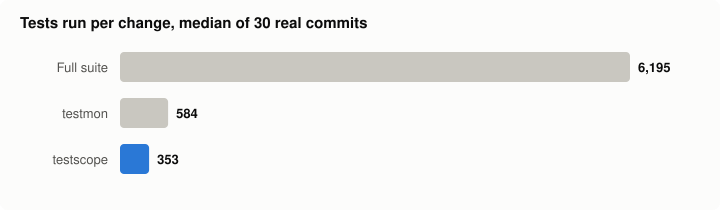

# testscope

Run only the tests your change can affect. Built for AI coding agents and CI.

Coding agents run `pytest` after every edit. On a 6,000-test suite that is minutes per
run. It goes past Claude Code's ~2-minute foreground limit, so the run moves to the
background and the agent stops reading its output. testscope records which code and
files each test really touches. After that, plain `pytest` runs only the tests your
change can reach.


On a real 6,195-test project, over its last 30 commits:



| | testscope | pytest-testmon | import graph |
|---|---|---|---|
| Median tests run per real commit (of 6,195) | **353** | 584 | 352 files of 378 |
| Injected faults caught (34 that break a test) | **33** | 22 | 22 |
| Faults in data files caught (YAML, JSON, shell) | **10 / 10** | 0 / 10 | 0 / 10 |
| Recording overhead on a 3m36s suite | none measured | +23 s | - |

Method, caveats and raw data: [`bench/RESULTS.md`](bench/RESULTS.md).

```bash
pip install testscope
pytest --testscope-record      # once (or in CI on main): full run + dependency map
# ... edit code ...
pytest --testscope             # only affected tests
```

When Claude Code runs pytest (it sets `CLAUDECODE=1`) and a map exists, selection turns
on automatically. The agent needs no new command and no hook. For other agents, export
`TESTSCOPE=on` in their environment.
`TESTSCOPE=off pytest` always runs everything. Explicit targets
(`pytest tests/test_x.py::test_y`) are never narrowed.

## What it tracks

| Dependency | How | testmon | import graph |
|---|---|---|---|
| Functions a test runs | `sys.monitoring` PY_START, disabled after the first hit, re-armed per test | yes (coverage) | no |
| Code run in child Python processes | `sitecustomize` on `PYTHONPATH`, tagged with the running test | no | no |
| Data files read (YAML, JSON, fixtures, shell scripts run) | audit hooks: `open`, `subprocess.Popen` | no | no |
| Files added to / removed from a listed directory | audit hooks: `os.listdir`, `os.scandir` | no | no |
| Module-level code (constants, decorators, class bodies) | by name: tests that ran code reading the changed name, in this module or its importers; plus up to 5 tests that import the module, to catch import crashes | yes | yes |
| Data files named by other files (a script that sources `_lib.sh`, a config that names a fixture) | one hop from files tests read; chains only through shell scripts | no | no |
| Config / lockfile change (`pyproject.toml`, `*.lock`, `requirements*.txt`, …) | full run | full run | no |
| Tests that failed last run | always rerun | yes | no |

Fingerprints are token-stream hashes without line numbers or comments, so moving code or
changing a comment selects nothing. The map is a *baseline*. Selection compares
the working tree with it by content, so it works on uncommitted edits and on
branches built from an older main. As you edit, the selection can only grow.
Re-record to reset it.

## AI step (optional)

```bash
pip install 'testscope[ai]'
export ANTHROPIC_API_KEY=...        # or TESTSCOPE_AI=claude to use your Claude Code login
pytest --testscope-ai               # or TESTSCOPE_AI=anthropic
```

A model reads the diff and a test index and names test files to run. It only adds files;
an error in the AI step never fails the run. With no map yet, it picks the files on its own.
`TESTSCOPE_AI_MODEL` (default `claude-opus-5-5`) and `TESTSCOPE_AI_EFFORT` (default `low`)
tune it. Results are cached per change, so xdist workers and reruns do not pay again.

Measured on the same faults ([`bench/RESULTS.md`](bench/RESULTS.md#ai-step)): with a map,
it caught nothing that testscope missed, and it adds a few tests. Without a map, it caught
33 of 34 faults while it ran about 3 test files, for about 1 cent per call on Opus 5.5
(0.05 cents on Haiku 5.5). Use it to start before you record a map.

## CI

[`examples/github-actions.yml`](examples/github-actions.yml):

- **push to main:** `pytest --testscope-record`; the map goes into the Actions cache.
- **pull requests:** restore the newest map; `pytest --testscope`.
- **merge queue + nightly:** plain full run. This is the safety net for what any selector can miss.

## Limits

- Recording needs Python 3.12+ (`sys.monitoring`). Selection works on any 3.9+.
- A test that starts a child process with a scrubbed environment (`env={}`), or with
  `python -I` / `-E`, hides that child's deps. Shell scripts that read files themselves
  are seen only as "script ran".
- Network services, databases and time are not dependencies. A flaky test stays flaky.
- Installing or upgrading a package is not detected. Re-record after dependency changes
  (a lockfile or `requirements*.txt` edit already triggers a full run).
- A module-level edit runs at most 5 "import canary" tests for crashes at import time.
- `eval`/`exec` strings and other dynamic code that no recorded test reached cannot be mapped.

## Evidence

[`bench/RESULTS.md`](bench/RESULTS.md): real commits and fault injection on one 6,195-test
project. For each injected fault, a full-suite run gives the ground truth. Missed files are
rerun to rule out flaky tests. The harness is in [`bench/`](bench/), so you can run it on
your own suite.
